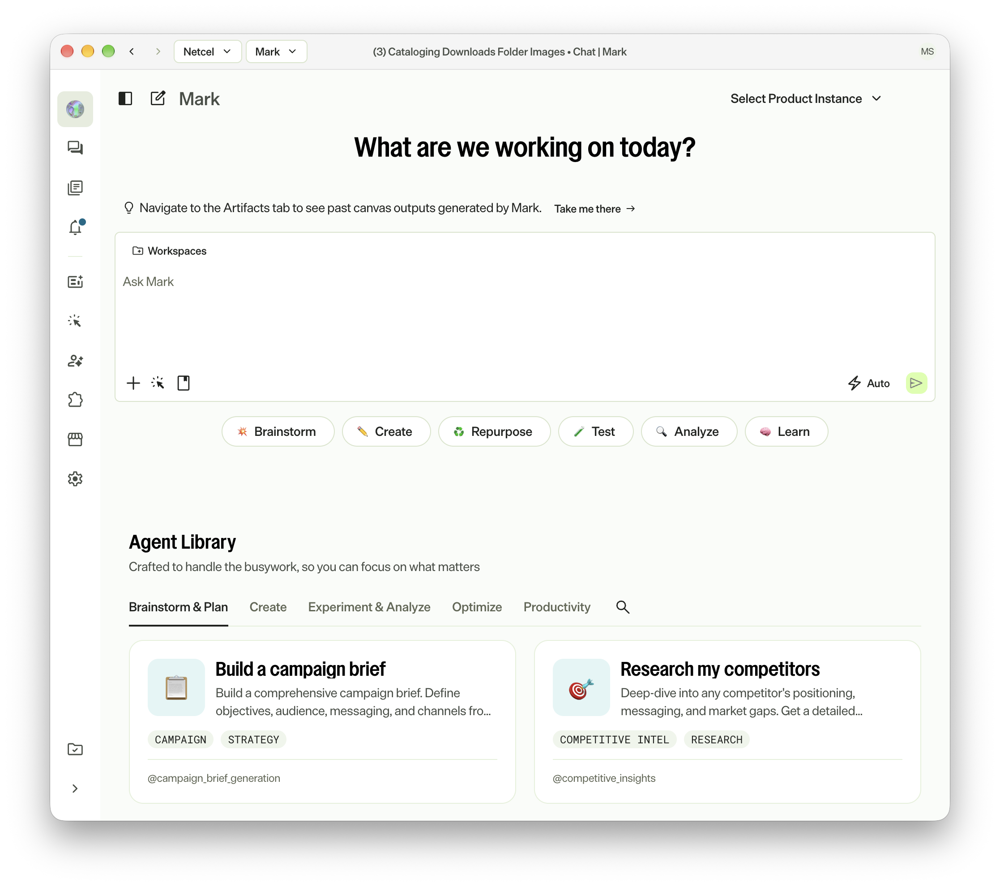
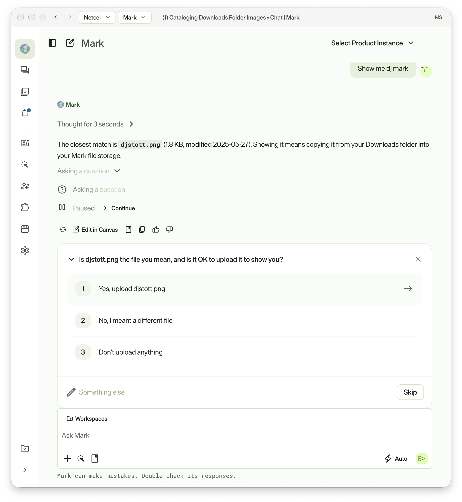
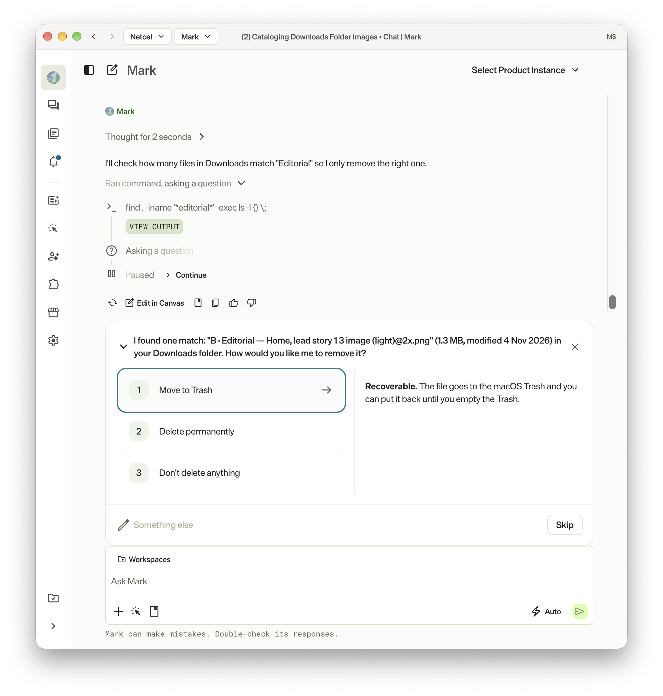
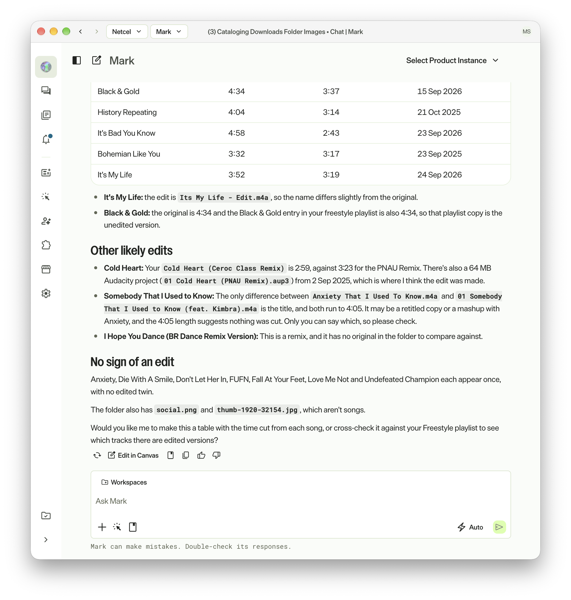

## What is Mark Desktop

Optimizely have announced the release of the Mark Desktop App.  Mark is the name for the Optimizely Agent Platform formerly known as Opal.  It is a play on the term **marketing** which was manifested as an entity called "Mark Eting" during much of Opticon and surrounding Optimizely marketing.

Historically, you could access Mark directly within the browser within the Optimizely platform.  There was the direct interface for Mark and then the side-loaded interface from other Optimizely products.

So where does Mark Desktop come in?  Mark Desktop provides the same UI experience as the specific Mark interface within the Optimizely platform, as seen on <a href="https://mark.optimizely.com" target="_blank">https://mark.optimizely.com</a>.

## Additional Functionality Available to Mark Desktop

Mark Desktop comes with additional functionality not available within the browser.  This includes a toolset that allows Mark to access your file system.  The following is a specific list of tools available to Mark Desktop at the time of writing; you can check for updated information on [Mark Desktop App - Optimizely Developer Documentation](https://docs.optimizely.com/agent-platform/docs/mark-desktop-app).

> - **List directory** – Browses files and subdirectories in a local folder. Returns file names, types, sizes, and modification dates.
> - **Read local file** – Reads the contents of a file on your computer.
> - **Write local file** – Creates a file or overwrites an existing file on your computer. Creates parent directories if needed.
> - **Search local files** – Searches for text content in files using plain text or regular expressions (regex). Returns matching lines with file paths and line numbers.
> - **File info** – Gets metadata about a file or directory, including size, type, permissions, modification date, and Multipurpose Internet Mail Extension (MIME) type.
> - **Delete local file** – Deletes a file or empty directory. Moves the file to your operating system trash by default.
> - **Upload file** – Uploads a file from your computer to Mark storage so agents can reference it in the conversation. The agent asks for your permission before uploading.
> - **Shell** – Run a shell command on your computer and returns the output. Commands time out after 60 seconds by default.

Guardrails are in place so that you have to specify the folders Mark Desktop has access to.  Mark will refer to these folders as **Workspaces**. Mark does not need a confirmation to read the contents of these folders, but will require point-in-time confirmation to perform updates and deletes.

### Browsing my Files

> Please note that for the purposes of these tests, I have had Mark access personal files rather than business files.

I gave Mark access to my Downloads folder as a Workspace on my MacBook and then ran a few tests. I then asked Mark to list all of the images in my Downloads folder and then to show me the "DJ Mark" image.  Mark then correctly identified this as djstott.png. In order to show me the image, Mark notified me it would need to upload the image to Mark file storage first. 

Following the upload, Mark notified me that the version now stored in Mark file storage had potentially been compressed.  I'm conflicted about Mark needing to upload the file in order to show me it. Why should it need to upload a local file in order to render it locally? If I switch to the browser experience, my chat history there includes the file and both the desktop and browser experience allow me to make further edits to the uploaded file within the canvas without affecting the locally stored file.

The second test I ran was to ask Mark "What is in my ceroc freestyle list?".  Mark found a file called **Freestyle 2024.03.22.xml** in my Downloads folder and ran a Python script to read it, then presented the results along with a summary.  Unlike the image test, Mark did not ask me to confirm it had found the right file, nor did it ask permission before running the script and reading the data.

In this scenario the file was not uploaded to Mark file storage, but the script's output was still sent to Mark for analysis and now forms part of the chat history.  This is an important distinction: while the raw file never left my machine, its contents did.  You will need to work out your own rules for which files Mark is allowed to access.

The third test I ran was to ask Mark "There is A B Editorial image in my downloads folder that I no longer want". Mark performed a search within the allowed folders until it found a single match and then prompted me with the options to "Move to Trash", "Delete permanently" or "Don't delete anything".  Choosing to send the file to the trash resulted in a macOS permission check to grant access to Finder so that Mark Desktop could perform the delete.

For my fourth test, I asked Mark what songs I had edited in my "Song Edits" folder.  Mark checked the folders it had access to, then proceeded to make a broader folder search.  It encountered an issue searching under the "Home" folder and prompted for a less broad search. After confirming it could search my "Documents" folder, Mark automatically defined a new Workspace for the Documents folder (essentially granting it future access beyond the current chat), it located the M4A files, matched up originals vs edits and provided a list of the edited tracks with their new and old durations.

## Shortcomings

Mark Desktop is a promising first release, but my tests turned up a few things you should be aware of before pointing it at anything sensitive.

### Confirmation Protects Your Files, Not Your Data

Mark asked for confirmation before uploading an image and before deleting a file, but it read the contents of my Freestyle list without verifying if it was the correct file at all.  This is consistent with the documentation, which states that read-only operations such as reading files and running inspection commands do not require confirmation.  The confirmations exist to stop Mark from changing your files, not to stop your data from being sent to Mark.

The Shell tool makes this more significant.  When I asked Mark to delete the Editorial image, it located the file by running `find . -iname '*editorial*' -exec ls -l {} \;` without asking, and the Python script in my second test also ran without a prompt.  The documentation doesn't say how a command is judged to be read-only, so in practice you are trusting Mark to make that call.

### Workspaces Are Not a Hard Boundary

Earlier I described Workspaces as the guardrail that controls which folders Mark Desktop can access.  The documentation adds a caveat: if you ask Mark to work with a file or folder it doesn't have access to, Mark Desktop automatically grants access to the containing directory.  It will only push back and ask for a more specific folder if that directory is too broad, such as your home folder or the root of your drive.

In my fourth test, Mark only asked because its search reached my home folder.  Based on the documentation, a single prompt that mentions a file outside of your Workspaces could result in that folder being added as an additional workspace and the file's contents being sent to Mark, all without you being asked.

### Uploading Files Just to View Them

As covered in my first test, Mark has to upload an image to Mark file storage before it can show it to you, even though the app and the file are on the same machine.  The uploaded copy may be compressed, and it persists in your chat history where it is available in the browser as well as the desktop app.  Viewing a local file shouldn't require handing over a copy of it.

None of these are reasons to avoid Mark Desktop, but they do mean that you should treat any folder you add as a Workspace, and any file you mention in a prompt, as data you are comfortable sharing with Mark.

## Conclusion

Overall, I think this is a great first release for Mark Desktop.  It's the same Mark you already know, just sat on your desktop instead of in a browser tab.  Your chats follow you between the desktop app and the browser, and if you've started something in the browser, you can pick it up in the desktop app with a single click.

Where I'd like to see it grow is around Workspaces.  There are two things I'd love to see in a future release:

- **Read-only Workspaces.**  Being able to mark a Workspace as read-only or editable would let me give Mark a look at a folder without worrying about it changing anything.
- **A clear heads-up when a new Workspace is added.**  When I asked about files outside my Workspaces, Mark quietly added my Documents folder as a Workspace that stuck around after the chat had finished.  I'd like Mark to tell me that's what is happening, and to ask before it keeps that access beyond the current chat.

Until then, it's a genuinely useful tool.  Just be choosy about which folders you let it into.